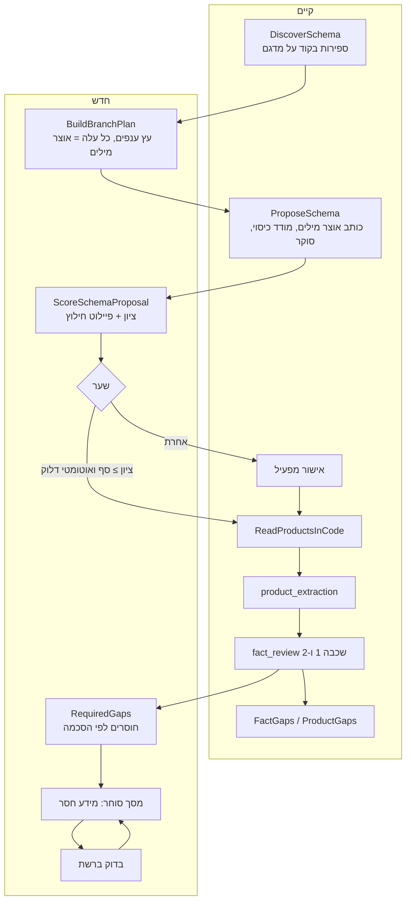

# סריקה ראשונית קפדנית — מפרט

> **עדכון:** 2026-10-14. **סטטוס:** חלק נבנה: סימון Try-On בקוד, `importance` ו‑`why` באוצר המילים, `RequiredGaps` ומסך מפעיל (ראו §12). השאר הצעה. החלטה: [ADR 0011](ADR/0011-strict-first-scan.md). נשען על `Enrichment` הקיים ([runbooks/agent-tasks.md](runbooks/agent-tasks.md)). שמות של מחלקות, מודלים וטבלאות שמסומנים **(לאמת)** נקבעים בעת המימוש מול הקוד.
> עלויות לפי [ADR 0003](ADR/0003-model-roles.md) והמחירון החי.

---

## 1. מה קיים ומה מוסיפים



| שלב | היום | אחרי |
|---|---|---|
| גילוי | הצעה אחת לחנות, מדגם | חבילת גילוי לכל החנות + תכנית ענפים |
| אוצר מילים | אחד לחנות, ענפים נוספים ביד / מתבנית | **אחד לכל עלה** של תכנית הענפים, עם רשימת "מה קונה צריך לדעת" |
| בדיקה | כיסוי + סקירה, אישור ידני תמיד | **ציון** + פיילוט + שער, אישור ידני עד שהציון מכויל |
| חוסרים | `FactGaps`: מה ש‑60% מהסוג יש לו | + `RequiredGaps`: מה שהסכמה מחייבת |
| השלמה | מסך מפעיל | **מסך סוחר** + "בדוק ברשת" + CSV |

---

## 2. תכנית ענפים — `BuildBranchPlan`

**קלט (קוד):** קטגוריות החנות (עם עומק), סוגי מוצר, תגיות, vendor, מאפיינים קיימים, ספירות ושכיחויות, 8 כותרות לדוגמה לכל קטגוריה, מוצרים בלי קטגוריה. חבילה מתומצתת עם מזהים (עד 30K טוקנים, הגדרה).

**מודל:** Claude Sonnet (תפקיד "תכנון קטגוריה" של ADR 0003), פלט JSON בלבד:

```json
{
  "branches": [
    {"key": "diamonds", "name": {"he": "יהלומים", "en": "Diamonds"}, "parent": "jewelry",
     "store_category_ids": ["c12","c40"], "template": "jewelry"}
  ],
  "unplaced_note": "3% בלי קטגוריה: לאוסף 'אחר'"
}
```

- **עלה** = ענף שמקבל אוצר מילים משלו. עלה קטן מ‑N מוצרים (ברירת מחדל 8) נבלע באב.
- אין שינוי בקטגוריות החנות. מוצר שייך לעלה ראשי אחד; מיפוי הקטגוריות כבר קיים ב‑`VocabularyBranch` (`root_category_external_id`).
- fingerprint של חבילת הגילוי: ללא שינוי ← אין קריאה.

---

## 3. אוצר מילים לכל ענף — `ProposeSchema` מורחב

הקיים נשאר: כותב + כיסוי + סוקר ממשפחה אחרת. מה שמשתנה:

1. **רץ לכל עלה**, עם הסטטיסטיקות של הענף בלבד (`SchemaStats` על מוצרי הענף).
2. **פרומפט חדש** (`schema_writer.v3`, גרסה חדשה, הישנות לא נערכות): רשימת בדיקה של מה שמשפיע על קנייה, ולכל מאפיין `importance`, `why`, ו‑`unknown_allowed`. עד 25 מאפיינים לעלה (הגדרה). מאפיין ירושה (מותג) מוגדר פעם אחת באב.
3. **דוגמאות מכוונות בפרומפט:** מקדחה ← סוללה כלולה (`included` / `body_only`), מספר סוללות, מתח (V), קיבולת (Ah), brushless, מצמד (מ"מ), מטען כלול, תיק כלול. יהלום ← קראט, צורה, ליטוש, צבע, ניקיון, תעודה, מעבדה. (ניטרלי: הדוגמאות בקובץ תבנית לפי ענף, לא הערות מכוונות.)
4. **כן/לא/לא ידוע:** מאפיין "כלול" נכתב כ‑`choice` עם ערך לכל מצב, כדי ש"לא כלול" יהיה עובדה ולא היעדר עובדה.
5. הפלט: אותו `VocabularyDefinition`, עם השדות הנוספים; קוד מאמת סכימה, קומפילציה של patterns, ו‑min/max ביחידות.

---

## 4. ציון ושער — `ScoreSchemaProposal`

### פיילוט
לכל עלה עד 5 מוצרים (ובסך הכול עד 10% מהקטלוג, עד 200, הגדרה), נבחרים לפי hash יציב, עם העדפה למוצרים "קשים" (תיאור קצר, בלי מאפיינים). על המדגם:

1. `ReadProductsInCode` במצב יבש (בלי כתיבה ל‑`EnrichmentFact`).
2. `product_extraction` לשאר, בתוך המערכת (Haiku, Batch, `SpendGuard`).
3. `RequiredGaps` על התוצאה: כמה מאפייני חובה מולאו עם ראיה.

### הציון (0–100, בקוד)

| רכיב | משקל | מקור |
|---|---|---|
| כיסוי: מוצרים ששויכו לעלה בביטחון | 15 | קוד |
| **אחוז מילוי בפיילוט** (חובה במלואו, מומלץ בחצי) | 30 | קוד |
| תקינות: יחידות, טווחים, ערכי enum, patterns שמתקמפלים | 10 | קוד |
| נפרדות: חפיפה בין עלים אחים | 10 | קוד |
| שיפוט הסוקר (`schema_review`, משפחה אחרת): מה חסר, מה מיותר | 25 | מודל |
| ראיות: מדגם ערכים שחולצו מול הציטוט | 10 | קוד + מודל קטן |

- הסוקר מחזיר JSON עם ציוני עלה וחסרים, **לא** ציון כולל.
- **כשל קשה** (עוצר בלי קשר לציון): מאפיין חובה במילוי 0% בלי אפשרות בטקסט, או יותר מ‑10% מהמוצרים בלי עלה.

### השער

| מצב | פעולה |
|---|---|
| ציון ≥ `enrichment.schema_pass_score` (80) וללא כשל קשה, והדגל `enrichment.schema_auto_advance` דלוק | ממשיכים לסריקה המלאה |
| אותו מצב, דגל כבוי (**ברירת מחדל**) | הציון מוצג, מחכה לאישור המפעיל |
| מתחת לסף, פחות מ‑2 תיקונים | הכותב מקבל את סעיפי הסוקר וחוזר; פיילוט וציון רק על עלים ששונו |
| נגמרו התיקונים | `needs_review` + התראה למפעיל: אשר, ערוך, הרץ מחדש עם הערה |

---

## 5. חוסרים — `RequiredGaps`

חוסר = מוצר שהענף שלו מגדיר מאפיין `required` (תמיד) או `recommended` (לפי הגדרת החנות) ואין לו עובדה מאושרת, ולא סומן "לא רלוונטי". מצטרף ל‑`FactGaps` (הסימן ל"רוב הסוג יש לו"). שניהם נבנים בקוד, בלי מודל, בתוך ה‑tenant.

---

## 6. מסך הסוחר "מידע חסר"

עברית, ללקוח קצה, **בלי מילה על מודלים או עלות**:

- ראש הדף: "ב‑{N} מוצרים חסר מידע שעוזר ללקוחות להחליט", ופס התקדמות של מוצרים שלמים.
- קבוצות: ענף ← מאפיין ← "חסר ב‑47 מוצרים". חובה קודם.
- עריכה בטבלה (תמונה, שם, שדה לפי סוג: מספר+יחידה / בחירה / כן‑לא‑לא ידוע), שמירה אוטומטית, קישור לעמוד.
- הצעות בביטחון נמוך: "נראה ש‑0.5 קראט? אשר / תקן".
- השלמה לקבוצה, "לא רלוונטי", ייצוא וייבוא CSV.
- הערך נשמר אצלנו כעובדה `Person` מאושרת ולא נדרס. הודעה: "המידע נשמר במערכת ומשפר חיפוש ותשובות. כדי לעדכן גם את החנות, אפשר להוריד קובץ."
- מייל שבועי רק כשיש שינוי (דרך הערוצים שקיימים).

---

## 7. "בדוק ברשת"

כפתור על חוסר (או קבוצה), לסוחר ולמפעיל:

1. **קלט בקוד:** שם, מותג, מק"ט, ברקוד/GTIN, יצרן. בלי מחיר, מלאי, עלות או הערות פנימיות. בלי מזהה חזק (מותג+דגם או ברקוד) הכפתור כבוי ואומר למה.
2. **`web_researcher`:** Claude Sonnet עם כלי חיפוש ברשת, שאלה אחת לכמה מאפיינים של אותו מוצר. פלט: ערך, יחידה, `certainty`, ומקורות עם `url`, `quote`, `same_product`.
3. **ודאות בקוד:** `certain` רק עם שני מקורות עצמאיים או מקור יצרן (דומיינים שהמפעיל מאשר), ציטוט מילולי שמכיל את הערך, ו‑URL שחזר 200 והציטוט נמצא בטקסט שלו. אחרת `likely`, `conflicting`, `not_found`.
4. **`web_verifier` (OpenAI):** האם הציטוט עוסק באותו דגם ולא בדומה לו.
5. **סוחר:** "מצאנו: 0.5 קראט. מקורות: ..." עם ציטוט וקישור; אשר / תקן / דחה. **לא נכתב כלום בלי אישור.** דחייה נשמרת ולא נשאלת שוב.
6. **עלות:** מכסה חודשית ויומית לחנות (ברירת מחדל 150 בדיקות, 10 $), בדיקה אחת לכל (מוצר, מאפיין) ל‑90 יום, וחיפוש אחד לכל המאפיינים החסרים של אותו מוצר. קבוצה ב‑Batch כשאפשר.
7. נשלחים נתוני מוצר ציבוריים בלבד.

---

## 8. מסך המפעיל

הרחבת `SchemaDiscovery` ו‑`ProductGaps`, בחמש לשוניות (חנות אחת בכל פעם):

1. **סקירה:** הציון הכולל ופירוקו מול הסף, כשלים קשים, מצב השער, עלות לפי שלב מול תקרה, היסטוריית גרסאות והשוואה ביניהן.
2. **עץ ענפים:** מספר מוצרים, ציון לכל עלה, מיפוי לקטגוריות החנות, מוצרים בלי עלה, שינוי מבנה (יוצר גרסה).
3. **מאפיינים ותגיות לכל ענף:** מפתח, שמות, סוג, יחידה, חשיבות, **למה**, אחוז מילוי, כמה מקוד וכמה ממודל, כמה לא ידוע; עריכה; התגיות שנוצרו.
4. **פיילוט וראיות:** מוצר, מה חולץ, מאיפה, הציטוט, ביטחון, פסק הסוקר; סינון "רק כשלים". קישור ל"יומן סריקה" (`ScanLog`) ולפעילות הסוכנים.
5. **בדיקות ברשת:** שאילתה, prompt, תשובה, מקורות וציטוטים, פסק ה‑verifier, החלטת הסוחר, עלות; שיעור אישור לפי ענף.

**הרשאות:** כל המסכים האלה, ה‑prompts, המודלים והעלויות: מפעיל בלבד. הסוחר רואה רק את "מידע חסר".

---

## 9. הערכת עלות לחנות של 1,200 מוצרים ו‑40 עלים (לאמת)

| שלב | עלות |
|---|---|
| גילוי + תכנית ענפים (Sonnet, 1–2 ריצות) | 0.1–0.3 $ |
| אוצר מילים לכל עלה (Sonnet, 40 קריאות קטנות) | 0.8–1.2 $ |
| סוקר (OpenAI, 40) | 0.2–0.3 $ |
| פיילוט (כ‑200 מוצרים, רק מה שהקוד לא מילא, Haiku Batch) | כ‑0.3 $ |
| סריקה מלאה: `product_extraction` + `fact_review` | לפי הקיים, בערך כמו היום |
| **תוספת חד‑פעמית** | **כ‑2–3 $** |

הרצה על ידי agents מחוץ למערכת (קבצי JSONL, כמו היום) עולה כלום למערכת. נכנס לתקרת AI ולא נוגע בתקרת המענה לגולשים.

---

## 10. בדיקות

- חילוץ יחידות ומידות (עברית ואנגלית), `Body only`, "ללא סוללה", "כולל מטען" (מתווסף ל‑`MeasurementScanner` / `PatternMatch` הקיימים).
- הציון: עלה ריק, מילוי 0%, כשל קשה, יציבות הסדר (מיון מפורש לפני hash).
- השער: עובר, מתקן ועובר, נתקע, אישור ידני, דגל כבוי ← לא ממשיך לבד; אין קריאה בלי `SpendGuard`.
- `FakeChatModel`; בדיקה ש‑`family(writer) != family(reviewer)` (קיימת ב‑Improvement; מורחבת).
- `RequiredGaps` מול `FactGaps`: אותו מוצר לא נספר פעמיים.
- "בדוק ברשת": `certain` רק עם שני מקורות עצמאיים וציטוט שנמצא בטקסט; דגם דומה אך שונה; מקורות סותרים; קישור מת; אין כתיבה בלי החלטה; מכסה ותקרה נאכפות.
- tenancy: סוחר לא רואה חנות אחרת ולא רואה מסכי מפעיל.
- סט זהב: חנות יהלומים וחנות כלי עבודה עם ערכים ידועים (גודל יהלום, סוללה כלולה).
- `i18n:check` לכל מחרוזת בשתי השפות.

---

## 11. שאלות פתוחות

1. סף השער: 80 כברירת מחדל, לכיול על שתי חנויות.
2. מה נספר כ"חוסר" כברירת מחדל: חובה בלבד (מוצע), ומומלץ כשהסוחר מדליק.
3. שמות מאפיינים בשתי שפות, או רק בשפת החנות?
4. כתיבה חזרה לחנות: אין (ADR 0005). אם יידרש, ADR נפרד.

---

## 12. מה נבנה (חלק 1)

בקוד, בלי קריאה למודל, עם בדיקות:

- **סימון Try-On לכל מוצר** (`Scanning/TryOnEligibility`): בגדים, תכשיטים ורהיטים שלמים בלבד. האוצר מילים אומר `"tryon": "ring"` על סוג מוצר (`top`, `bottom`, `dress`, `outerwear`, `ring`, `bracelet`, `necklace`, `earrings`, `watch`, `furniture`); `"tryon": false` על ענף שלם; `tryon_exclude_patterns` לחלקים ואביזרים. סוג שלא סומן בענף שמצהיר = `none`. ענף שלא אומר דבר = לא מסומן ("לא הוחלט"), ולא "לא". ריהוט: חלק או כיסוי ("רגליים לספה", "כרית לספה", "cover for sofa") הוא `none` גם כשהסוג הוא ריהוט. נשמר כעובדה `FactKind::TryOn` (`class`), נכתב ב‑`ReadProductsInCode`, והסימן הוא חלק מהקריאה (שינוי בו = קריאה מחדש).
- **נעליים, משקפיים וכובעים** אינם ברשימה (נבחר: רק בגדים, תכשיטים, רהיטים שלמים). להוסיף מחלקה זה שורה ב‑`TryOnEligibility::CLASSES`.
- **`importance` (`required` / `recommended` / `optional`) ו‑`why` לכל מאפיין** ב‑`VocabularyDefinition`, עם אימות. ברירת המחדל `optional`, כך שאוצרות מילים קיימים לא שואלים דבר חדש.
- **`RequiredGaps`**: מוצר בענף ללא ערך מאושר למאפיין חובה / מומלץ שחל על הסוג שלו. מאפיין כן/לא (`boolean`) לא נספר כי הקוד שומר רק "כן"; מאפיין שחשוב לדעת אם כלול נכתב כבחירה (`included` / `body_only`).
- **מסך המפעיל "פערים במידע על מוצרים"** מציג: כמה מוצרים סומנו ל‑Try-On, כמה לא, וכמה לא הוחלט; ואת החוסרים לפי הסכמה, עם "למה".
- תבנית `jewelry`: סוגי הטבעת, העגילים, השרשרת והתליון, הצמיד והשעון סומנו ל‑Try-On (צמיד רגל, סיכה, חפתים ותליון‑מערכת לא); `metal` חובה; `gold_karat`, `stone` ו‑`carat_weight` (גודל האבן) מומלצים.

**עוד לא נבנה:** תכנית ענפים (`BuildBranchPlan`), `schema_writer.v3` שמבקש ממודל לכתוב `importance`/`tryon`, ציון ופיילוט ושער, מסך הסוחר, "לא רלוונטי", ו"בדוק ברשת".

**סימון לפי תמונה (בהמשך):** שלב נפרד אחרי סריקת התמונות יוסיף עובדה `tryon_image` (תמונה נקייה ומתאימה, מתאימה רק על דגם, לא מתאימה) ויבטל Try-On למוצר שאין לו תמונה שמתאימה. עד אז הסימון נשען על הסוג בלבד.
