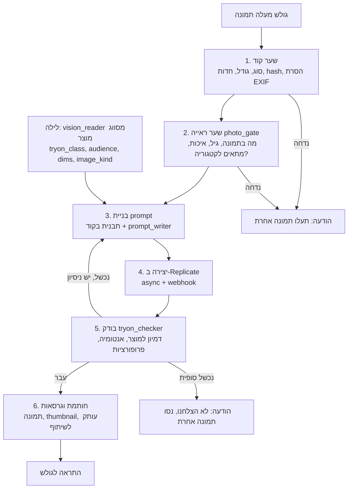

# מודול Try-On — מפרט

> **הוסר: 2026-10-16** (החלטת הבעלים). החנות עברה למגירה אחת, "Lets Search" (`Search/resources/search/lets-search.js`), ו‑Try-On לא עבר איתה. ראו §17. מה שלמטה הוא התיעוד של מה שנבנה, לשם ההיסטוריה.

> **עדכון:** 2026-10-14. **סטטוס:** הצעה. החלטה: [ADR 0012](ADR/0012-try-on.md). מחירי Replicate **לא אומתו מול Replicate עצמה**, רק מאגרגטורים. לאמת בריצת ה‑bake-off (§7) לפני קביעת תקרה.
> **מה זה המסמך:** צינור ה‑Try-On, הטבלאות, ה‑API, החלון, המתג, העלות, הלוג והמסכים.

## על מה זה נשען (קיים)

| צריך | קיים כבר | מה מוסיפים |
|---|---|---|
| העלאת תמונה של גולש, קריאה במודל ראייה, cache לפי תמונה, ספירה יומית | `Search`: `SearchPhotoController`, `ReadPhotoTags`, `KeepPhotoSearch`, `CheckPhotoSearches`, `photos_per_day`; `Ai\Contracts\VisionModel` | שער Try-On (`GatePhoto`) מאותו דפוס, עם תוצאה שמורה לתמונה |
| סיווג מוצר (סוג, קהל יעד, מידות) | `Enrichment`: אוצר מילים לכל ענף, עובדות `FactKind::Choice/Spec`, `ReadProductsInCode` | מאפיינים `tryon_class`, `audience`, `dims`, `image_kind` בסכמות הענפים ([strict-scan.md](strict-scan.md)) |
| מוצרים דומים | `ComputeProductRelations`, `SemanticSearch::similarTo()`, `LookAlike` | סינון לפי `tryon_class` |
| מתג לכל חנות או לכולן | `Features` (דריסת חנות, אחר כך דריסה גלובלית, אחר כך ברירת המחדל של המודול) | דגל `tryon.enabled`, כבוי כברירת מחדל |
| כפתור בעמוד, חלון | `Widget`: `let-agents.js`, bank לעמוד, משתני `--let-agents-*` | כפתור וחלון Try-On |
| שאלה בסוכן | `Assistant` | פעולה `try_on` (פותחת את החלון) |
| תקרת הוצאה, רישום עלות, Run | `Ai\Contracts\SpendGuard`, `RunContext::usage()`, `Runs` | תקרה נפרדת ל‑Try-On, ו‑`ImageDriver` חדש (Replicate) |
| זהות גולש ומסירת הודעה | `Shoppers` (`VisitHistory`, `Support\Channels`), `Sms` | התראה כשהתמונה מוכנה |

> **שמות:** הקוד קורא היום לדייר `Shop` (`shop_id`). ההחלטה היא לעבור ל‑`Site` ([ADR 0013](ADR/0013-shop-to-site.md)); במסמך הזה הטבלאות כתובות `site_id`.

---

## 1. מה הגולש מקבל

| מוצר | מה הגולש מעלה | מה הוא מקבל |
|---|---|---|
| טבעת, צמיד, שעון | יד | המוצר על האצבע / פרק היד |
| שרשרת, עגילים | צוואר / אוזן | המוצר עליו |
| נעליים, גרביים | רגליים | המוצר על הרגל |
| חולצה, מעיל, שמלה, מכנסיים | גוף (חצי / מלא) | הלבוש עליו |
| משקפיים, כובע | פנים | המוצר על הפנים |
| ריהוט, תאורה, שטיח, תמונה | צילום של החלל | המוצר בחלל, בקנה מידה |

התוצאה היא **הדמיה בלבד**. הגולש סוגר את החלון והעבודה ממשיכה; כשהתמונה מוכנה הוא מקבל התראה.

---

## 2. המתג

- דגל `tryon` ב‑`module.json` (`features`), ברירת מחדל גלובלית **כבוי**.
- שלושה מצבים לכל אתר: `ירושה` (ברירת מחדל) / `מופעל` / `כבוי`. הערך האפקטיבי = דריסת האתר, אחרת הגלובלי.
- מסך מפעיל **Try-On › אתרים**: טבלת כל האתרים עם המתג, שימוש החודש, עלות, אחוז הצלחה. כפתור "הפעל לכולם" / "כבה לכולם".
- כבוי = `/api/v1/widget/{site}/tryon/*` מחזיר 404, הכפתור לא נבנה ב‑bank, עבודות תלויות מבוטלות, והמסכים של הסוחר מוסתרים.
- הגדרות (typed, bounded, ב‑`module.json` → `settings`), לכל אתר עם ברירת מחדל גלובלית:

| הגדרה | ברירת מחדל | גבולות |
|---|---|---|
| תקרה חודשית ל‑Try-On לאתר | 20 $ | 1–500 |
| תקרת עלות למשימה (כולל ניסיון חוזר) | 0.25 $ | 0.05–2 |
| יצירות לגולש ביום | 5 | 1–30 |
| ניסיונות חוזרים אוטומטיים | 1 | 0–2 |
| מוצרים דומים בחלון | 8 | 0–16 |
| שמירת תמונות גולש (ימים) | 90 | 7–365 |
| שמירת תמונות קטינים (ימים) | 90 (הוחלט: אותה שמירה לכולם) | 7–365 |
| דורש אישור הורה לתמונת ילד | כן | נעול (לא ניתן לכבות) |
| מודל יצירה לכל סוג מוצר | ראו §7 | רישום |

---

## 3. צינור בשישה שלבים



### שלב 0 — סריקת התמונות בלילה (סיווג מוצר)

> **עדכון:** אחרי [ADR 0011](ADR/0011-strict-first-scan.md), `tryon_class`, `audience`, `image_kind` ו‑`dims` הם **מאפיינים בסכמות של העלים** (תכשיטים, הנעלה, לבוש, ריהוט) שנבנות בסריקה הקפדנית ([strict-scan.md](strict-scan.md)), ולא שדות נפרדים. הטבלה למטה נשארת ההגדרה של ערכיהם.

מתווסף לסכימת הראייה של `vision_reader` ([ADR 0008](ADR/0008-search-pictures-and-daily-review.md)), **באותה קריאה** ובאותו Batch. שדות חדשים, נשמרים ב‑`facts` עם `origin = visual`:

| שדה | ערכים | שימוש |
|---|---|---|
| `tryon_class` | `ring`, `bracelet`, `watch`, `necklace`, `earrings`, `shoes`, `top`, `bottom`, `dress`, `outerwear`, `eyewear`, `hat`, `furniture`, `decor`, `unsupported` | בחירת סוג התמונה הנדרשת, המודל והתבנית. `unsupported` = אין כפתור |
| `footwear / apparel / jewelry / furniture` | קבוצת על | סכימת הענף |
| `audience` | `adult`, `teen`, `child`, `baby`, `unisex_adult` + `gender` | התאמה לאדם בתמונה (§3 שלב 2) |
| `image_kind` | `packshot`, `flat_lay`, `on_model`, `lifestyle`, `unclear` | איזו תמונת מוצר נשלחת למודל היצירה. הכי נקייה גוברת |
| `best_image_id` | מזהה `media` | נבחר בקוד לפי `image_kind` |
| `look_notes` | טקסט קצר: צבע, חומר, גימור, פרטים | נכנס ל‑prompt |

מידות (`size`): **בקוד** מתוך מאפייני המוצר (WooCommerce attributes, Shopify metafields/variants) ומהטקסט עם regex (`ס"מ`, `מ"מ`, `cm`, `mm`, `×`). אם חסרות מידות לרהיט: הכפתור מופיע רק אם `furniture_dims_required = false`, והבודק מסמן "פרופורציות לא מאומתות". המודל מציע מידות רק כשהקוד לא מצא, ותמיד עם `origin = model` ו‑`status = draft` לאישור צוות.

כל שינוי בתמונה (`image_hash`) או בסכימה (גרסה) מזמין סריקה מחדש של אותו מוצר בלבד. אין שינוי: אין קריאה (fingerprint).

### שלב 1 — שער קוד (0 טוקנים)

- סוג MIME אמיתי (לא סיומת): jpeg / png / webp / heic (הומר), עד 12MB.
- מינימום 600px בצלע הקצרה; יחס מוגזם נדחה.
- חדות (שונות Laplacian) ובהירות ממוצעת: מטושטשת או חשוכה מאוד נדחית כבר כאן.
- הסרת EXIF (כולל מיקום), סיבוב לפי כיוון, כיווץ ל‑2048px, `photo_hash`.
- אם `photo_hash` כבר עבר שער ראייה לאתר הזה: **דילוג על שלב 2** (הגולש לא משלם שוב, וזה מה שמאפשר "מוצרים דומים בלחיצה").

### שלב 2 — שער ראייה `photo_gate`

קריאה אחת, מודל ראייה זול (ברירת מחדל `gpt-5.4-nano`, ב‑OpenAI), פלט JSON לפי סכימה בלבד, **בלי טקסט חופשי** שהגולש רואה:

```json
{
  "subject": "hand|foot|body_upper|body_full|face|neck|ear|room|other",
  "people_count": 0,
  "age_group": "adult|teen|child|baby|none|unclear",
  "visible_parts": ["fingers","wrist"],
  "quality": "ok|blurry|dark|cropped|occluded",
  "scale_cues": {"hand_width_ratio": 0.0, "door_visible": false, "floor_visible": true},
  "room": {"style": "", "light": "", "free_wall": true},
  "unsafe": false,
  "usable_classes": ["ring","bracelet","watch"],
  "reject_code": null
}
```

כללי החלטה **בקוד** על הפלט, לא במודל:

| תנאי | תוצאה |
|---|---|
| `unsafe` או תוכן לא הולם | נדחה, `reject_code = unsafe` |
| `quality != ok` | נדחה, `unclear_photo` |
| `tryon_class` של המוצר לא ב‑`usable_classes` | נדחה, `wrong_subject` (למשל טבעת + תמונת רגל) |
| `people_count > 1` ובמוצר לבוש | נדחה, `multiple_people` |
| מוצר `child`/`baby` ואדם `adult`/`teen` | נדחה, `adult_for_child_item` |
| מוצר `adult` ואדם `child`/`baby` | נדחה, `child_for_adult_item` |
| `age_group = unclear` ומוצר ילדים/מבוגרים | נדחה, `age_unclear` |
| מוצר `child` ואדם `child` | עובר רק עם אישור הורה (§11) |

ההודעות לגולש הן **מפתחות lang** (`he`/`en`) לפי `reject_code`, לא טקסט של מודל, למשל: "הבגד הזה לילדים. כדי לראות אותו, העלו תמונה של הילד/ה." / "לא זיהינו יד בתמונה. העלו תמונה אחרת." מדגם 10% מהשערים נבדק במשפחה השנייה (`vision_verifier`, Claude Haiku) ומחזיר ל‑`photo_gate` רק ציון הסכמה.

התוצאה נשמרת ב‑`tryon_photos` ומשמשת כל מוצר תואם אחר של אותו גולש.

### שלב 3 — בניית prompt

1. **תבנית בקוד** לפי `tryon_class` (`Prompts/tryon/{class}.v{n}.md`, גרסה נעולה כמו כל prompt). חריצים: סוג מוצר, `look_notes`, מידות אמיתיות, מה לשמר (זהות האדם, רקע, תאורה, פוזה), מה אסור (שינוי הפנים, אצבעות מיותרות, עיוות המוצר).
2. **חישוב פרופורציות בקוד**: יחס המוצר לגוף או לחלל מתוך המידות ומרמזי הקנה מידה של שלב 2. דוגמאות: רוחב טבעת מול רוחב אצבע; גובה ארון מול גובה דלת (≈ 204 ס"מ) או רוחב הקיר החופשי; אורך שמלה מול גובה האדם. התוצאה נכנסת כמשפטים מספריים ("הארון: 180×60×200 ס"מ, כ‑88% מגובה הדלת").
3. **קריאה אחת ל‑`prompt_writer`** (ברירת מחדל OpenAI `gpt-5.4-mini`), קלט מתומצת: עובדות המוצר, עובדות התמונה, התבנית והפרופורציות. פלט JSON: `{prompt, negative_prompt, notes}`. מטרתה: ניסוח מדויק אחד שמחבר בין מה שבתמונה לבין המוצר. אם `tryon_class` יש לו תבנית מלאה ואין חריגים, אפשר לוותר על הקריאה (הגדרה `prompt_writer_mode: template | model`, ברירת מחדל `model` עד שה‑bake-off מוכיח שאפשר בלי).
4. **fingerprint** = hash(תבנית וגרסה + `best_image_id` + `photo_hash` + מודל יצירה + מידות). זהה לקודם: מחזירים את התוצאה השמורה בלי יצירה חדשה.

ה‑prompt המלא, כפי שנשלח, נשמר בלוג (§9).

### שלב 4 — יצירה ב‑Replicate

- `ImageDriver::generate(images[], prompt, options)` ← `POST /v1/predictions` עם `Prefer: respond-async`, `webhook` חתום, ו‑`webhook_events_filter: ["completed"]`. תמונות קלט כקבצים/URL חתומים קצרי חיים מהאחסון שלנו.
- הסטטוס מגיע ב‑webhook (`POST /api/v1/webhooks/replicate`, חתימה מאומתת). ב‑Octane אין המתנה חסומה: מקרה של webhook שלא הגיע נתפס בבדיקת polling ב‑scheduler אחרי 90 שניות.
- `SpendGuard::assertCanSpend(estimate)` לפני השליחה. עלות בפועל מהתשובה של Replicate (`metrics.predict_time` × תעריף חומרה, או מחיר קבוע לכל תמונה) נרשמת ב‑`ai_ledger` ובשלב.
- **בחירת מודל לפי סוג מוצר**: טבלת `tryon_model_bindings` (class → model_id → גרסה → פרמטרים). ברירת המחדל מוצעת ב‑§7.

### שלב 5 — בודק `tryon_checker`

קריאת ראייה אחת של Claude Haiku (`claude-haiku-4-5`, sync), עם **שלוש תמונות**: המוצר המקורי, תמונת הגולש, והתוצאה. פלט JSON בלבד:

```json
{
  "product_similarity": 0,
  "identity_kept": true,
  "anatomy_ok": true,
  "proportions_ok": true,
  "artifacts": ["extra_finger"],
  "background_kept": true,
  "verdict": "pass|retry|fail",
  "reason_code": null
}
```

- `pass` בקוד = `product_similarity >= 4` (מתוך 5, הגדרה) וכל הבוליאנים אמת וללא `artifacts` חמורים.
- `retry`: ניסיון חוזר אחד (הגדרה), עם prompt שמוסיף את התיקון ("העצם נראה קצר מדי, שמרו על 88% מגובה הדלת") או עם מודל חזק יותר לפי הרישום. מוגבל בתקרת העלות למשימה.
- `fail` סופי: הגולש לא רואה תמונה פגומה. מקבל הודעה לפי `reason_code` והצעה להעלות תמונה אחרת. התמונה הפגומה נשמרת בלוג בלבד.
- מדגם 5% נבדק גם במשפחה השנייה (`gpt-5.4-mini` עם ראייה) כדי לנטר את הבודק עצמו.

### שלב 6 — חותמת, גרסאות והתראה

- הגרסאות נוצרות בקוד: מקור נקי, תצוגה (1280px), thumbnail, **עותק עם חותמת** לשמירה ולשיתוף.
- **התגית בטקסט חי**: ב‑DOM, מעל התמונה (פינה עליונה, כמו ב‑VSIO), `<div class="la-ai-note">` עם `lang` ו‑`dir`: "התמונה נוצרה באמצעות AI ויכולה להיות לא מדויקת". לא בתוך הפיקסלים, כדי שתהיה נגישה, ניתנת לתרגום ולהגדלה. בשמירה / שיתוף, השרת מצייר אותה בעותק נפרד (GD/Imagick), והקובץ המקורי נשאר נקי.
- הסטטוס עובר ל‑`ready` ונשלחת התראה (§6).

---

## 4. מוצרים דומים: לבדוק בלי להעלות מחדש

- בפתיחת החלון, ה‑bank מכיל `tryon.similar`: עד 8 מוצרים **מאותו `tryon_class`** מתוך מה שהרכיב כבר מחשב בלילה: `ComputeProductRelations` (חלופות מאותו סוג) ו‑`SemanticSearch::similarTo()` (וקטורים שמורים), בלי מודל. שדה `tryable` מחושב בלילה (יש תמונה טובה, יש קטגוריה נתמכת).
- ברגע שיש לגולש תמונה שעברה שער (`photo_id`), הדפדפן מסמן כל מוצר כ"מוכן" אם `tryon_class` שלו ב‑`usable_classes` של התמונה, וגם הקהל (`audience`) מתאים. **בלי קריאה לשרת, בלי שער שני.**
- לחיצה על מוצר מוכן = `POST tryon/jobs` ישיר עם `photo_id`: דולג שלב 1–2, נשארים בנייה, יצירה, בדיקה.
- אם החליף תמונה: השער רץ פעם אחת על החדשה.
- אין יצירה אוטומטית "לכולם". אף יצירה לא קורית בלי לחיצה, כדי לא לשרוף תקציב.
- מוצר עם תוצאה שמורה לאותה תמונה (אותו fingerprint): נפתח מיד, בלי עלות.

---

## 5. הטבלאות

כל הטבלאות עם `site_id` ו‑`BelongsToTenant`.

| טבלה | שדות עיקריים | הערות |
|---|---|---|
| `tryon_photos` | visitor_hash, photo_hash, storage_path, thumb_path, gate_result (JSON), usable_classes, age_group, status (ok/rejected), reject_code, parental_consent_at, expires_at | נשמר גם כשנדחה. מנוע הדילוג על שער |
| `tryon_jobs` | photo_id, document_id, variant_id, tryon_class, fingerprint, status (queued/gating/prompting/generating/checking/ready/failed/cancelled), attempt, model_binding_id, result_image_id, cost_usd, started_at, finished_at, notify_state, run_id | job אחד = תהליך אחד. `run_id` מצביע על ה‑Run הרגיל בלוג הסוכנים |
| `tryon_steps` | job_id, position, step (code_gate/vision_gate/prompt_build/prompt_writer/generate/checker/stamp), attempt, status, input (JSON), output (JSON), **prompt_text**, role, provider, model, model_version, tokens_in, tokens_out, tokens_cache_read, batch, cost_usd, duration_ms, error, summary_he, summary_en | שורה לכל שלב וכל ניסיון. זה הלוג שהמפעיל רואה |
| `tryon_images` | job_id (nullable), step_id, kind (user_photo/product_ref/result/result_failed/thumb/share_stamped), path, width, height, bytes, hash, created_at, expires_at | כל קובץ שנגע בתהליך |
| `tryon_model_bindings` | tryon_class, provider, model_id, version, params (JSON), cost_estimate_usd, status (active/candidate/retired), is_default | הרישום שמאפשר להחליף מודל בלי פריסה |
| `tryon_notifications` | job_id, visitor_hash, channel (in_page/email), address (מוצפן, אופציונלי), sent_at, opened_at | |
| `tryon_benchmarks` | name, golden_set, binding_id, scores (JSON), cost_total_usd, ran_at | השוואת מודלים (§7) |

`facts` מקבל את `kind` החדש `tryon` (מפתחות: `class`, `audience`, `dims`, `image_kind`). `Run.kind = tryon`.

---

## 6. ה‑API

### החוצה (site key ציבורי, בדיקת origin, rate limit לפי אתר וגולש, anti-bot)

| נתיב | מודל? | מה |
|---|---|---|
| `GET /api/v1/widget/{site}/tryon/config` | לא, מטמון | האם פעיל, הטקסטים, תגית ה‑AI, הגבלות העלאה |
| `GET /api/v1/widget/{site}/tryon/similar/{document}` | לא, מטמון ארוך | המוצרים הדומים עם `tryon_class` ו‑`audience` |
| `POST /api/v1/widget/{site}/tryon/photos` | **כן** (שער ראייה, רק אם `photo_hash` חדש) | העלאה ← `{photo_id, status, reject_code, message, usable_classes}` |
| `POST /api/v1/widget/{site}/tryon/jobs` | **כן** (בניית prompt, יצירה, בודק, ברקע) | `{photo_id, document_id, variant_id}` ← 202 `{job_id}`. מחזיר מיד תוצאה שמורה אם יש |
| `GET /api/v1/widget/{site}/tryon/jobs/{id}` | לא | סטטוס. polling עם backoff (3, 5, 8 שניות). בלי סודות |
| `GET /api/v1/widget/{site}/tryon/looks` | לא | ה"מראות" הקודמים של הגולש (לפי visitor_hash) לחיוג ה"7 looks ready" |
| `DELETE /api/v1/widget/{site}/tryon/photos/{id}` | לא | הגולש מוחק תמונה שלו (גם קבצים, וגם קישור התוצאות) |

### פנימה

| נתיב | מה |
|---|---|
| `POST /api/v1/webhooks/replicate` | סיום יצירה. חתימה מאומתת. idempotent לפי prediction id |

### ביטול

אם `tryon` כבוי לאתר: כל הנתיבים מחזירים 404. עבודות בתור מסומנות `cancelled` ואינן נשלחות.

---

## 7. מודלים, בחירה ו‑bake-off

### מה אפשר לומר היום

אי אפשר לקבוע "הכי טוב" בלי מבחן על הקטלוג שלך. מהחיפוש (גורמים שלישיים, לא Replicate עצמה):

| מודל (Replicate) | מחיר משוער לתמונה | הערה |
|---|---|---|
| Google Nano Banana (Gemini Flash Image) | כ‑0.04 $ | תמיכה בכמה תמונות קלט, שימור זהות טוב. **הבחירה ההתחלתית** לכל הסוגים |
| FLUX Kontext Pro | כ‑0.04 $ | עריכה לפי הוראה, חזק בשימור. מועמד ראשי שני |
| FLUX.2 Pro Edit | כ‑0.04 $ | מועמד |
| Seedream (ByteDance) | 0.035–0.06 $ | מועמד, חזק בחלל וריהוט |
| IDM-VTON וכדומה | לא נמצא מחיר | ייעודי ללבוש בלבד (עליון / תחתון), לא לתכשיט, נעל או רהיט. מועמד זול ללבוש |
| Reve / Wan 2.7 Edit / Kling O1 | 0.05–0.22 $ | יקרים. רק אם מנצחים בבדיקה |

**ברירת מחדל מוצעת:** Nano Banana לכל `tryon_class`, כי הוא מקבל את תמונת המוצר ותמונת הגולש יחד. FLUX Kontext Pro כגיבוי ולניסיון חוזר. זו הגדרה ב‑`tryon_model_bindings`, לא קוד.

### ה‑bake-off (שלב ראשון בבנייה)

1. סט זהב: 20 מוצרים לכל קבוצה (תכשיט, נעל, לבוש, ריהוט) ו‑6 תמונות גולש לכל אחת, כולל מקרים גרועים.
2. כל מועמד רץ על אותו סט עם אותו prompt. הבודק (§3.5) נותן ציון; בנוסף דירוג אנושי עיוור של 20% במסך השוואה בפאנל.
3. מדד: אחוז `pass` בניסיון ראשון, ציון דמיון ממוצע, עלות ל‑`pass` (לא עלות לניסיון), זמן.
4. הנוצחים נכנסים ל‑`tryon_model_bindings` כברירת מחדל לכל סוג. שאר המודלים נשארים `candidate`.
5. **מסך השוואה** במפעיל: אותו קלט בשני מודלים זה לצד זה, עם עלות, כדי לבדוק מודלים חדשים בהמשך בלי קוד ([ADR 0003](ADR/0003-model-roles.md)). הרישום החי מציע `model_suggestion` כשיוצא מודל תמונה חדש.

### תפקידים חדשים (נכנסים לטבלה ב‑03)

| תפקיד | מה עושה | ברירת מחדל | מצב |
|---|---|---|---|
| `tryon_classifier` | סיווג מוצר (חלק מ‑`vision_reader`) | Claude Haiku 4.5 | Batch, 0 קריאות נוספות |
| `photo_gate` | שער ראייה על תמונת גולש | OpenAI `gpt-5.4-nano` | sync |
| `photo_gate_verifier` | מדגם 10% | Claude Haiku 4.5 | sync |
| `prompt_writer` | prompt מדויק לפי המוצר והתמונה | OpenAI `gpt-5.4-mini` | sync |
| `image_generator` | יצירת התמונה | Replicate, לפי `tryon_model_bindings` | async + webhook |
| `tryon_checker` | בדיקת תקינות ודמיון | Claude Haiku 4.5 (ראייה) | sync |
| `tryon_checker_verifier` | מדגם 5% | OpenAI `gpt-5.4-mini` | sync |

---

## 8. עלות: מה רואים ומה זה

### הערכה למשימה אחת (לאמת)

| שלב | עלות משוערת |
|---|---|
| שער קוד | 0 |
| שער ראייה (nano + תמונה) | ≈ 0.001 $ (דילוג אם הצילום כבר עבר) |
| prompt_writer (mini) | ≈ 0.001 $ |
| יצירה (Nano Banana / Kontext) | ≈ 0.04 $ |
| בודק (Haiku, 3 תמונות) | ≈ 0.004 $ |
| **משימה מוצלחת** | **≈ 0.05 $** |
| עם ניסיון חוזר אחד | ≈ 0.095 $ |

אתר עם 300 משימות בחודש: כ‑15–25 $. לכן תקרה משלו (§2) ולא `ai.monthly_spend_cap_usd` (6 $ לכל החנויות).

### איפה מוצגת העלות

- **לכל משימה, פירוק לפי שלב** (`tryon_steps.cost_usd`, סך ב‑`tryon_jobs.cost_usd`): מסך הלוג (§9). שורת סיכום בעברית ב‑`Run`, כמו כל קריאה במערכת, ו‑`ai_ledger` לכל קריאה.
- **לפי אתר ולפי מודל**: מסך Try-On › עלויות. עלות ל‑`pass`, עלות לגולש, עלות לכל מוצר שנבדק, והצגה מול ההמרה (הוספה לסל אחרי Try-On, ראו §10).
- **בלי עלויות אצל הסוחר.** הסוחר רואה כמה בדיקות בוצעו וכמה הושלמו, לא כסף ולא מודלים (כלל קיים ב‑CLAUDE.md).
- התראה למפעיל כשהאתר ב‑80% מהתקרה. ב‑100%: הכפתור מוחלף בהודעה ("הבדיקה לא זמינה כרגע") ולא נוצרות משימות חדשות. משימות שכבר רצות מסיימות.

---

## 9. שקיפות ולוג: רואים כל שלב

### מסך מפעיל **Try-On › יומן** (ברירת מחדל: 50 המשימות האחרונות)

טבלה: זמן, אתר, מוצר, תמונת הגולש (thumbnail), התוצאה (thumbnail), סטטוס, מספר ניסיונות, עלות, משך. מסננים: אתר, סוג מוצר, סטטוס (הצליח / נדחה בשער / נכשל בבדיקה / שגיאה), מודל, טווח זמן, "רק מה שנכשל". חיפוש לפי מזהה משימה.

### מסך משימה (לחיצה על שורה): ציר זמן אנכי

לכל שלב, בסדר, כרטיס אחד עם:

| שלב | מה מוצג |
|---|---|
| 1 שער קוד | התמונה כפי שהתקבלה, מה נבדק (גודל, חדות, בהירות), עבר / נדחה ולמה |
| 2 שער ראייה | **התמונה, ה‑prompt המלא, ה‑JSON שחזר**, החלטת הקוד (למה עבר / נדחה, איזה `reject_code`), מודל, טוקנים, עלות, משך. אם דולג: "דולג, תמונה זו אושרה ב‑{תאריך}" |
| 3 בניית prompt | התבנית וגרסתה, החריצים שמולאו, חישוב הפרופורציות (המספרים), **ה‑prompt הסופי + negative prompt**, מה ה‑prompt_writer שינה (diff מול התבנית), fingerprint |
| 4 יצירה | המודל והגרסה, הפרמטרים, **תמונות הקלט שנשלחו**, מזהה ה‑prediction ב‑Replicate (קישור), זמן יצירה, עלות, התוצאה |
| 5 בודק | **שלוש התמונות זו לצד זו**, ה‑JSON של הבודק, ציון הדמיון, ההחלטה, אם נעשה ניסיון חוזר ובאיזה תיקון |
| ניסיון חוזר | אותו פירוט, מקופל כ"ניסיון 2", עם diff של ה‑prompt מול ניסיון 1 |
| 6 חותמת והתראה | הגרסאות שנוצרו, התראה שנשלחה ומתי, האם נפתחה |

בראש הדף: **סיכום** (תוצאה, סך עלות מפורקת לשלבים, משך כולל, כמה ניסיונות) וכפתורים: **"הרץ שוב עם מודל אחר"** (פותח את מסך ההשוואה), **"הרץ שוב עם prompt ערוך"** (ה‑prompt נערך ונשלח כגרסת ניסוי שמסומנת כך, לא נכנסת לקאש), **"סמן כתוצאה גרועה / טובה"** (נכנס לסט הזהב), **"מחק תמונות"**.

כל הטקסט בכרטיסים הוא נתון גולמי מהשלב (prompt, JSON). הוא לא נערך בדיעבד, כמו שגרסת prompt שיצאה לא נערכת.

### הרשאות

| מסך | מפעיל | סוחר |
|---|---|---|
| יומן ומסך משימה (prompts, JSON, עלות, מודלים) | ✔ | — |
| **סוחר: רק ספירה** ("נבדקו {N} מוצרים, {M} מראות הושלמו"). **בלי** שלבים, prompts, תמונות גולש, מודלים או כסף. הוחלט: התהליך נראה למנהל המערכת בלבד | — | ✔ (ספירה) |
| Try-On › אתרים, עלויות, מודלים, השוואה, bake-off | ✔ | — |

---

## 10. חלון הגולש

מבוסס על המבנה של VSIO (לא על המותג שלהם): כפתור על תמונת המוצר, חלון מודאלי, מצב טעינה, תוצאה עם הגדלה, שורת תמונות, ופעולות. העיצוב נלקח מהאתר כמו שאר הרכיב (משתני `--let-agents-*` של הרכיב הקיים), RTL כברירת מחדל, מובייל קודם.

| אזור | מה יש |
|---|---|
| כפתור בעמוד המוצר | "נסו על עצמכם" (או "ראו בחלל שלכם" לריהוט). רק כש‑`tryon` פעיל, `tryon_class` נתמך ויש תמונה טובה. הכפתור נטען מה‑bank, בלי קריאה לשרת |
| חלון | כותרת: שם המוצר ומחיר. אזור תצוגה: התוצאה, כפתור הגדלה, **תגית ה‑AI בטקסט חי** בפינה |
| העלאה | כפתור העלאה + צילום מהמצלמה במובייל. טקסט מותאם לקטגוריה ("העלו תמונה של היד"). שורת הסבר על פרטיות ואישור (§11) |
| שורת תמונות | תמונות הגולש (בחירה = החלפת תמונה) ולצידן **מוצרים דומים** בשורה נפרדת, ממוינת כך שה"מוכנים" ראשונים, עם סימן "מוכן" |
| טעינה | "יוצרים את המראה שלכם…" עם שלבי התקדמות אמיתיים (נבדקת התמונה / מכינים / יוצרים / בודקים), מ‑polling |
| סגירה | סגירת החלון לא מבטלת. מופיע **צ'יפ צף** בפינה ("הבדיקה בתהליך" ← "המראה מוכן") גם אחרי ניווט בין עמודי האתר, מ‑`localStorage` (`job_id`) |
| נדחה | הודעה לפי `reject_code` והעלאה מחדש בלחיצה אחת, בלי לסגור את החלון |
| פעולות | הוספה לסל (כולל וריאנט), שמירה, שיתוף (העותק עם החותמת), החלפה למוצר דומה |

### התראה אחרי סגירה

1. **בדף (ברירת מחדל, בלי מידע אישי):** הצ'יפ הצף מתעדכן ל"המראה מוכן", ולחיצה פותחת את התוצאה. עובד כל עוד הגולש נמצא באתר.
2. **מייל (רשות):** שדה אימייל אופציונלי עם אישור מפורש. כשהתמונה מוכנה והגולש לא באתר: מייל עם קישור חתום ל‑`looks`, בתוקף 7 ימים. הכתובת נשמרת מוצפנת ונמחקת עם התמונות. נשלח דרך הערוצים של `Shoppers` (`SupportChannels`): מייל רק כשיש mailer אמיתי, טלפון כשיש ספק SMS (מודול `Sms`). גולש בלי זהות מאומתת מקבל רק את הצ׳יפ.
3. Web Push: לא בשלב ראשון.

### אנליטיקס (event-spec)

`tryon.open`, `tryon.upload`, `tryon.rejected` (עם reject_code), `tryon.start`, `tryon.ready`, `tryon.failed`, `tryon.similar_click`, `tryon.save`, `tryon.share`, `tryon.cart_add`. כמו כל אירוע: בלי פרטים מזהים.

### גם ככלי של הסוכן

הסוכן (Assistant) מקבל פעולה `try_on`: כששואלים "איך זה ייראה עליי / אצלי בסלון", התשובה כוללת כרטיס עם כפתור שפותח את חלון ה‑Try-On לאותו מוצר. הפעולה **לא מריצה יצירה בעצמה**; היא רק פותחת את החלון, ולכן אין בה עלות. הפעולה נרשמת ב‑`assistant.actions` ורק כש‑`tryon` פעיל לאתר.

---

## 11. פרטיות, בטיחות וקטינים

- אין שליחת תמונת גולש לשום ספק לפני אישור מפורש ("התמונה תעובד על ידי שירותי AI ותישמר {N} ימים"). האישור נשמר עם חותמת זמן.
- EXIF נמחק לפני אחסון. אין שימוש בתמונות לאימון: משתמשים ב‑API בלבד, ובהגדרות של הספקים שלא לשמור לאימון (לבדוק לכל ספק במסמך ה‑runbook).
- **קטינים (הוחלט: מותר):** מוצר ילדים דורש תמונה של ילד, ואז חובה אישור הורה (תיבת סימון נעולה, נשמר עם חותמת זמן). מוצר בוגרים נדחה לתמונת ילד. ללא אישור הורה לא מועבר דבר לספק. שמירה 90 יום כמו כולם, ללא שיתוף ציבורי, וקישור שיתוף מבוטל כברירת מחדל לתמונות קטינים.
- תמונות לא הולמות: נדחות בשער, נשמרות בלוג לצורך ביקורת בלבד, ונמחקות לפי מדיניות שמירה קצרה.
- הגולש יכול למחוק תמונה ותוצאה בכל רגע (`DELETE`), והמחיקה כוללת את הלוג שלהן (הקבצים; שורת הלוג נשארת בלי נתיב).
- שימוש בתמונה של אדם אחר: אין דרך לאמת. הטקסט בחלון מבקש להעלות תמונה של עצמכם (או של ילדכם), וההגנה היחידה היא הגבלות הקצב והמכסה.
- הגנה על התקציב: rate limit, בדיקת origin, anti-bot (Cloudflare Turnstile), מכסה יומית לגולש, ובדיקה ש‑`photo_hash` זהה לא מייצר יצירות כפולות.

---

## 12. בדיקות

- יחידה: חילוץ מידות, חישוב פרופורציות, החלטות השער (כל שורה בטבלת §3.2), בחירת `best_image_id`, fingerprint.
- Feature (`FakeChatModel`, `FakeImageDriver`): כל `reject_code`; ילד + בוגר בשני הכיוונים; דילוג על שער לתמונה מוכרת; תוצאה שמורה = 0 עלות; כשל בודק + ניסיון חוזר; עצירה בתקרת עלות; webhook כפול; webhook שלא הגיע.
- **אין מודל בנתיבי `/w/*` חוץ מ‑`/ask`, `tryon/photos`, `tryon/jobs`**, ואין מודל ב‑`tryon/*` כשהדגל כבוי (404).
- tenancy: סוחר / גולש של אתר אחד לא רואה תמונות, משימות או לוג של אתר אחר.
- `i18n:check` לכל `reject_code` ולכל טקסט בחלון.
- ארכיטקטורה: `TryOn` מייבא רק ממודולים שהצהיר עליהם.
- סט זהב: ה‑bake-off (§7) הוא גם בדיקת רגרסיה בכל החלפת מודל או prompt.

---

## 13. המודול

`app/Modules/TryOn`, `requires`: `Tenancy`, `Runs`, `Ai`, `Connections` (בדיקת origin), `Catalog`, `Enrichment`, `Retrieval`, `Analytics`, `Shoppers`, `Admin`.

**כיוון התלות:** `Widget` ו‑`Assistant` מוסיפים `TryOn` ל‑`requires` וקוראים רק מ‑`TryOn\Contracts` (למשל `TryOnAvailability`: האם פעיל, מה הכפתור). `TryOn` לא מייבא אותם, ולכן אין מעגל.

| מה | איפה |
|---|---|
| ספק תמונות | `AiProviderName::Replicate` + `Ai\Contracts\ImageDriver` (חדש) + `Ai\Support\Drivers\ReplicateImages`. המפתח נשמר בפאנל כמו שאר הספקים (`ProviderKey`) |
| דגל | `tryon.enabled` (`Features`, כבוי) |
| הגדרות | `tryon.monthly_cap_usd`, `tryon.job_cap_usd`, `tryon.jobs_per_visitor_per_day`, `tryon.retention_days` (90), ועוד מ‑§2, ב‑`module.json` |
| רישום סוגי מוצר | `TryOn\Support\TryOnClasses` ← תבנית prompt, סוג התמונה הנדרש מהגולש, מידות חובה |
| סוכנים בלוג | `tryon.photo_gate`, `tryon.prompt_writer`, `tryon.generator`, `tryon.checker` ב‑`AgentCatalog` |

Actions: `GatePhoto`, `BuildTryOnPrompt`, `GenerateTryOn`, `CheckTryOn`, `StampImage`, `NotifyShopper`, `RunBenchmark`.

---

## 14. סדר בנייה

1. **bake-off ידני** (סקריפט, בלי מודול): 3–4 מודלים על 30 מוצרים. תוצאה: ברירות מחדל והערכת עלות אמיתית.
2. מבנה המודול, הדגל, `ImageDriver` + Replicate + webhook, טבלאות.
3. מאפייני Try-On בסכמות הענפים (שלב 0): נבנים כחלק מהסריקה הקפדנית ([strict-scan.md](strict-scan.md)); עד אז אפשר להתחיל מאוצר מילים ידני לענף אחד (תכשיטים).
4. שערים (1–2) ו‑`tryon/photos`.
5. prompt, יצירה, בודק, `tryon/jobs`, ציר ה‑`tryon_steps`.
6. החלון, הצ'יפ הצף, ההתראות, מוצרים דומים.
7. מסכי המפעיל: יומן ומסך משימה, עלויות, אתרים ומתג, השוואת מודלים. מסך הסוחר.
8. הפעולה `try_on` של הסוכן.

---

## 15. שאלות פתוחות

**הוחלט (2026-10-14):** תמונות ילדים מותרות עם אישור הורה; שמירה 90 יום; אחסון ב‑Railway (Bucket, S3-compatible); התהליך וה‑prompts נראים למנהל המערכת בלבד.

1. **התראה במייל:** להפעיל כבר בגרסה ראשונה, או רק הצ'יפ בדף? (ברירת מחדל: שניהם, המייל רק באישור מפורש.)
2. **ריהוט בלי מידות:** להסתיר את הכפתור, או לאפשר עם סימון "פרופורציות משוערות"?
3. **מחירים:** כל מחירי Replicate כאן הם מאגרגטורים. לאמת מול החשבון בצעד 1.

---

## 16. מה נבנה (חלק 1: השרת)

> **עדכון 2026-10-14.** מודול `TryOn` (`app/Modules/TryOn`) עם 11 בדיקות; Replicate ב‑`Ai` עם 3 בדיקות. **החלון בחנות עוד לא נבנה** (העיצוב שלו בערכת העיצוב, מחוץ לריפו).

- **המתג:** `try_on.enabled` (שם המודול בקוד הוא `try_on`, לא `tryon`), כבוי. דריסה לחנות או גלובלית דרך `Features`. כבוי: כל הנתיבים מחזירים 404.
- **Replicate:** ספק חדש `AiProviderName::Replicate` (משפחה משלו), המפתח נשמר ב"ספקי AI" ונבדק מול `/v1/account`. `ImageModel` / `ImageDriver` / `ReplicateImages`: חיזוי שמחכים לו בבקשה (`Prefer: wait=60`) ואז polling עד 240 שניות; כל מודל מקבל את התמונות בשם שהוא מצפה לו (`ReplicateImages::INPUTS`). ברירת מחדל `google/nano-banana` לכל קבוצה (הגדרות `try_on.model_apparel|jewelry|furniture`).
- **שער התמונה** (`GatePhoto`): קוד (GD) קודם: קובץ תמונה אמיתי, צלע קצרה ≥ 500px, לא חשוך, לא מטושטש; התמונה מסובבת ונשמרת מחדש (בלי EXIF). אחר כך מבט אחד של מודל ראייה זול שאומר רק מה רואים, והקוד מחליט. **נדחה:** שני אנשים או יותר, מי שנראה מתחת ל‑18, תוכן לא הולם, תמונה לא ברורה, חדר עם אנשים (לרהיט), תמונה בלי מה שהמוצר צריך. אותה תמונה שוב לא נבדקת שוב. בלי אישור הלקוח לא נשלח דבר.
- **שאלה לפני יצירה** (`TryOnClasses::questions`): כמה אצבעות נראות: "על איזו אצבע לשים את הטבעת?"; שתי ידיים: "על איזו יד?"; שתי אוזניים: "על איזו אוזן?"; בחדר יותר ממקום פנוי אחד: "איפה בחדר להציב?" (המקומות כפי שמודל הראייה תיאר). בלי תשובה מתוך האפשרויות לא נוצרת תמונה. התשובה נכנסת לפרומפט ולבדיקה.
- **המדידה** (`StartTryOn` → `RunTryOnJob` → `RunTryOn`): המוצר חייב סימון Try-On מהסריקה; התמונה חייבת להראות מה שהסוג צריך; מכסה ללקוח ליום ותקציב חודשי לחנות (`try_on.monthly_cap_usd`, נפרד מתקציב ה‑AI). פרומפט = תבנית הצוות לקבוצה (`Prompts/tryon_{apparel|jewelry|furniture}.v1.md`) שכותב (OpenAI) מדייק למוצר, לתמונה ולתשובות; יצירה ב‑Replicate; בודק (Claude) רואה מוצר, תמונה ותוצאה זו לצד זו ונותן ציון. נדחה ← ניסיון חוזר עם התיקון שלו, עד `try_on.retries` ועד `try_on.job_cap_usd`. לא עבר: לא מוצג. אותה מדידה שוב (אותה תמונה, מוצר, תשובות, מודל, גרסאות) מחזירה את מה שכבר נוצר.
- **API** (`/api/v1/try-on/...`): `{site}/config`, `{site}/photos`, `{site}/tries`, `{site}/tries/{id}`, ו‑`file` עם כתובת חתומה שפגה. בדיקת origin ומפתח אתר כמו בשאר החנות; הלקוח כ‑hash מלוח לחנות; rate limit `try-on`.
- **יומן למפעיל** ("יומן Try-On"): 50 המדידות האחרונות, וכל מדידה עם כל השלבים: בדיקת קוד, מבט, פרומפט כפי שנשלח, יצירה, בדיקה; התמונות של כל שלב, המודל, הטוקנים, הזמן והעלות. **לסוחר** רק ספירה חודשית.
- **שמירה ומחיקה:** הקבצים בדיסק `upsell.tryon_disk` (`TRYON_DISK`, ב‑Railway: `s3` עם ה‑Bucket). `try-on:prune` כל לילה ב‑03:50 מוחק תמונות שעברו את ימי השמירה של החנות (90); השורות נשארות ביומן בלי נתיבים.
- **ילדים:** אין בגרסה הזו מסלול לילדים. תמונה שמישהו בה נראה מתחת ל‑18 נדחית ("העלו תמונה שלכם").
- **לפני הפעלה:** מפתח Replicate בפאנל; לאמת `try_on.generation_usd_per_image` מול המחירון של המודל; `TRYON_DISK=s3` ב‑Railway; להדליק `try_on.enabled` לחנות אחת; מדידה אחת אמיתית ולבדוק ביומן. **לא נבדק מול Replicate האמיתי.**
- **החלון בחנות (נבנה, חלק 2):** `let-agents-tryon.js` (`/api/v1/try-on/let-agents-tryon.js`). הרכיב טוען אותו רק כשה‑bank אומר `tryon` (החנות הדליקה והמוצר מסומן); הוא מוסיף כפתור "נסו על עצמכם" / "ראו בחלל שלכם" לשורת הרכיב או לתגיות הבלוק. העלאה או צילום אחרי אישור, דחייה עם הסיבה, **שאלה לפני יצירה** (אצבע, יד, אוזן, מקום בחדר), שלבים אמיתיים מהשרת, צ'יפ צף אחרי סגירה (גם אחרי מעבר עמוד, באותו מוצר), תוצאה עם הגדלה והתגית בטקסט חי, הוספה לסל דרך הכפתור של החנות, שמירת התמונה. הטקסטים מגיעים מהשרת (`try_on::try_on.ui`, עברית ואנגלית).
- **עוד לא:** מוצרים דומים בחלון, עותק לשיתוף עם חותמת, ה‑bake-off של המודלים. **החלון לא נבדק בדפדפן מול שרת אמיתי** (רק תחביר ובדיקות השרת).

- **בדיקה של הצוות לפני שהמדידה פועלת ללקוחות:** בכל עמוד מוצר מוסיפים לכתובת `?let_agents_preview=<מפתח התצוגה של החנות>&let_agents_tryon=1`. על מוצר שהסריקה לא סימנה, במקום `1` כותבים את הסוג: `ring`, `bracelet`, `necklace`, `earrings`, `watch`, `top`, `bottom`, `dress`, `outerwear` או `furniture`. זה נשאר בדפדפן יום אחד; `let_agents_tryon=0` מכבה. השרת בודק את המפתח (בלי מפתח: 404 כמו ללקוח), וכל המגבלות והעלויות נספרות. הקישור עם המפתח מופיע בראש "יומן Try-On".

---

## 17. הוסר (2026-10-16)

> החלטת הבעלים: Try-On הוסר. החנות מציגה רק את מגירת החיפוש "Lets Search", ו‑Try-On לא נכלל בה.

- **הוסר:** החלון בחנות (`let-agents-tryon.js`), הנתיבים `try-on/{site}/config`, `{site}/photos`, `{site}/tries`, `{site}/tries/{id}` ו‑`try-on/file` (עונים 404), ה‑controller, הפעולות (`GatePhoto`, `StartTryOn`, `RunTryOn`, `PickProductPicture`), `RunTryOnJob`, `Picture`, `TryOnClasses`, הפרומפטים, המסכים ("יומן Try-On" למפעיל, הסיכום לסוחר) וכל הגדרות `try_on.*`.
- **נשאר:** `GET /api/v1/try-on/let-agents-tryon.js` עונה 200 עם סקריפט ריק (`/* Lets Search: Try-On was removed */`, אותן כותרות מטמון), לחנויות שעוד על תוסף ישן. הדגלים `try_on.enabled` (כבוי) ו‑`try_on.paused` (דלוק) נשארים מוצהרים, כי קוד אחר עוד שואל אותם.
- **הנתונים נשארים:** הטבלאות `try_on_photos`, `try_on_jobs`, `try_on_steps`, `try_on_files` והשורות שלהן (כולל הפרומפט שנשלח בכל שלב והעלות), והמודלים. שום טבלה לא נמחקה.
- **פרטיות:** `try-on:prune` ממשיך לרוץ כל לילה ב‑03:50 ומוחק את התמונות שעבר תאריך השמירה שלהן (`expires_at`, שנקבע כשהתמונה הגיעה); השורות נשארות בלי נתיבים.
- **סימוני הסריקה** (`FactKind::TryOn`, `TryOnEligibility` ב‑Enrichment) לא נגעו: הם ידע על המוצר.
